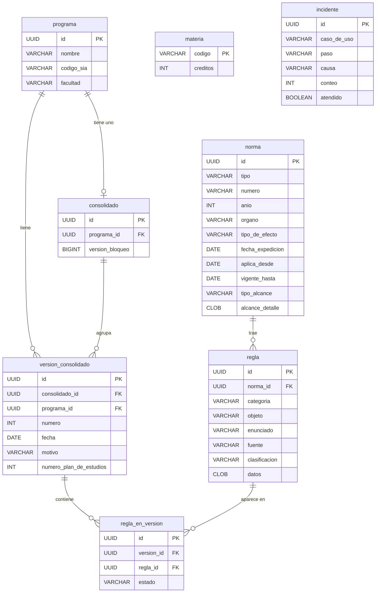

# Esquema de la base de datos

## 0′ · Cuándo cargar este archivo

Antes de escribir una migración o una consulta, al revisar qué dejó guardado una carga de normativa y al demostrar un cambio con una consulta sobre la base. Para la forma del archivo que **entra**, ve a [`formato-normativa.md`](formato-normativa.md).

Este documento es **derivado**: la fuente del esquema son las migraciones de `src/main/resources/db/migration/`. Describe las tablas como están hoy, tras `V2`; si difiere de las migraciones, mandan ellas. Las cifras y las consultas se ejecutaron el 12 de noviembre de 2026 sobre una base nueva cargada con la semilla.

## Tablas y relaciones



El diagrama muestra las columnas principales; la lista completa está en las migraciones. `materia` e `incidente` no tienen llaves foráneas.

| Tabla | Una fila es | Lo que la base garantiza | Notas |
| --- | --- | --- | --- |
| `programa` | Un programa cargado | Solo la llave primaria | El código SIA único lo cuida `ImportacionDeProgramasService`, no la base |
| `norma` | Una norma incorporada | Única por `tipo`, `numero`, `anio` y `organo` | Por esa identificación, la importación omite una norma ya registrada (UC07 ext. 4c) |
| `regla` | Una regla de una norma | `norma_id` existe | Las columnas comunes a toda regla, y en `datos` lo propio de su categoría. `regla_afectada_id` no es llave foránea |
| `consolidado` | El consolidado de un programa | Uno por programa | `version_bloqueo` es el contador de bloqueo optimista de JPA (`@Version`). No es el número de la versión del consolidado |
| `version_consolidado` | Una versión del consolidado de un programa | Única por `programa_id` y `numero` | Solo se agregan filas. `motivo` es `POR_INCORPORACION`, `POR_CORRECCION`, `AUTOMATICO_POR_PERIODO` o `AUTOMATICO_POR_FECHA` |
| `regla_en_version` | Que una regla está en una versión, y con qué estado | Única por `version_id` y `regla_id` | `estado` es `VIGENTE`, `PROGRAMADA` o `YA_NO_RIGE`. Una versión lleva las reglas de la anterior más las de la norma incorporada, así que una misma regla tiene una fila por cada versión en que está |
| `materia` | Una materia del catálogo: código y créditos | Solo la llave primaria | Hoy queda vacía: la importación todavía no la llena ([#155](https://github.com/SamuelGomezG/RutaUN/issues/155)) |
| `incidente` | Un grupo de incidentes iguales sin atender | Solo la llave primaria | `conteo`, `primera_fecha` y `ultima_fecha` resumen las ocurrencias. `programa_id` y `version_consolidado` son nulos en un incidente interno |

## Columnas que guardan JSON como texto

No se usan columnas de tipo JSON: son `CLOB` con texto que escriben y leen los mappers de `normativa/aplicacion` ([`cambios-de-boot-4.md`](../proceso/cambios-de-boot-4.md), «Verificado en los carriles 2 y 3»). La excepción es `version_consolidado.detalle_motivo` (`VARCHAR(300)`), detallada abajo.

| Columna | Qué guarda | Ejemplo |
| --- | --- | --- |
| `regla.datos` | Los datos propios de la categoría de la regla. La categoría la dice la columna `categoria`, no el JSON | `{"creditos":{"valor":10},"tipo":"MINIMO"}` en una regla `CARGA_POR_PERIODO` |
| `norma.alcance_detalle` | Facultades, programas, exclusiones y texto del alcance. Los programas van por su `id`, no por el código SIA del archivo | `{"facultades":[],"programas":["6c6d…"],"exclusiones":[],"texto":"…"}` |
| `version_consolidado.detalle_motivo` | Los datos del motivo de la versión. Excepción a la convención: es `VARCHAR(300)`, no `CLOB`; el mapper limita el detalle a 300 caracteres | `{"norma":{"valor":"205c…"},"administrador":"Semilla de desarrollo"}` |
| `version_consolidado.cambios` | Los cambios respecto a la versión anterior | Hoy `null` |
| `incidente.elementos` | Los elementos involucrados. No es JSON: es una lista ordenada y separada por comas | — |

Tres cosas que no se deducen del esquema:

- **El JSON guardado sigue la forma de las clases del dominio**, y no la del archivo de importación. Los subtipos llevan el discriminante `@tipo` (`AGRUPACION`, `MATERIA_DEL_PROGRAMA`, `Y`, `O`…).
- **Es un formato provisional y sin versión.** Si cambia una clase del dominio, lo ya guardado puede dejar de leerse; qué hacer está en [`cambios-de-boot-4.md`](../proceso/cambios-de-boot-4.md). Los records propios de persistencia y el campo de versión llegan con [#145](https://github.com/SamuelGomezG/RutaUN/issues/145).
- **Mientras no haya cuentas**, quien crea una versión va como texto dentro de `detalle_motivo` y `administrador_id` queda en `null`.

## Migraciones

| Archivo | Qué crea |
| --- | --- |
| `db/migration/V1__esquema.sql` | Las siete tablas de Normativa |
| `db/migration/V2__incidente.sql` | `incidente` |
| `src/test/resources/db/humo/V0__humo.sql` | La tabla `humo`. Solo existe con el perfil `test` |

Flyway registra lo aplicado en la tabla `flyway_schema_history`. Cómo agregar una migración está en [`recetas.md`](../proceso/recetas.md).

## Cambios abiertos sobre el esquema

Antes de apoyarte en un detalle de una tabla, revisa si uno de estos issues lo cambia. Quien cierre uno actualiza este documento en la misma solicitud de integración.

| Issue | Qué cambia |
| --- | --- |
| [#140](https://github.com/SamuelGomezG/RutaUN/issues/140) | Guardar con un `id` repetido sobrescribe la fila en vez de fallar |
| [#141](https://github.com/SamuelGomezG/RutaUN/issues/141) | El esquema no guarda vigencias por periodo ni el inicio de una afectación: `aplica_desde` y `vigente_hasta` son fechas |
| [#142](https://github.com/SamuelGomezG/RutaUN/issues/142) | El esquema se aparta del diseño y acepta datos incoherentes |
| [#143](https://github.com/SamuelGomezG/RutaUN/issues/143) | Un repositorio por raíz, sin borrado del historial |
| [#145](https://github.com/SamuelGomezG/RutaUN/issues/145) | Los datos de las reglas, en columnas JSON |
| [#152](https://github.com/SamuelGomezG/RutaUN/issues/152) | El estado de las reglas pasa a la versión del consolidado |
| [#155](https://github.com/SamuelGomezG/RutaUN/issues/155) | El catálogo de materias queda vacío |
| [#167](https://github.com/SamuelGomezG/RutaUN/issues/167), [#168](https://github.com/SamuelGomezG/RutaUN/issues/168) y [#169](https://github.com/SamuelGomezG/RutaUN/issues/169) | Cómo se agrupan los incidentes y qué pasa con dos registros simultáneos |

## Qué deja la semilla

Con una base nueva y el perfil `dev`:

| Tabla | Filas |
| --- | --- |
| `programa` | 1 |
| `norma` | 5 |
| `regla` | 280 |
| `consolidado` | 1 |
| `version_consolidado` | 5 |
| `regla_en_version` | 880 |
| `materia` | 0 |
| `incidente` | 0 |

Las cinco versiones salen del orden en que se cargan los archivos ([`entorno-y-configuracion.md`](../proceso/entorno-y-configuracion.md), «Qué hace el arranque»):

| Versión | Norma incorporada | Reglas de la norma | Reglas de la versión | Versión del plan de estudios |
| --- | --- | --- | --- | --- |
| 1 | Acuerdo 003-A de 2022, Consejo Académico | 20 | 20 | 1 |
| 2 | Acuerdo 008 de 2008, Consejo Superior Universitario | 7 | 27 | 1 |
| 3 | Acuerdo 11 de 2023, Consejo de Facultad de Ingeniería | 249 | 276 | 2 |
| 4 | Acuerdo 902 de 2026, Consejo de Facultad de Ingeniería (datos de prueba) | 1 | 277 | 2 |
| 5 | Acuerdo 901 de 2026, Consejo de Facultad de Ingeniería (datos de prueba) | 3 | 280 | 2 |

Las 880 filas de `regla_en_version` son la suma de las reglas de cada versión (20 + 27 + 276 + 277 + 280). En la versión vigente (la 5), 279 quedan `VIGENTE` y 1 `PROGRAMADA`; una de las vigentes tiene `vigente_hasta`. La fecha de cada versión es el día de la carga, no la de la norma.

Los dos archivos `datos-de-prueba-*.json` son ficticios y llevan la marca «(datos de prueba)»; su convención está en [`formato-normativa.md`](formato-normativa.md), «Datos de prueba de la semilla».
Cada dato se retira solo cuando su caso pase a estar cubierto por una norma real: los demás se conservan, y las cifras de esta tabla y de `SemillaDeSistemasTest` se recalculan con los datos que queden; `DatosDePruebaDeLaSemillaTest` y `SoporteDeSemilla` descubren los archivos por su nombre y no fijan cifras. Retirar un archivo no limpia una base ya cargada: hay que borrar `data/` y volver a arrancar con `dev`.

Estas cifras cambian cuando cambie la semilla: [#178](https://github.com/SamuelGomezG/RutaUN/issues/178) (doce agrupaciones registradas dos veces) y [#146](https://github.com/SamuelGomezG/RutaUN/issues/146) (orden de carga). [#146](https://github.com/SamuelGomezG/RutaUN/issues/146) reordena la carga por fecha de expedición: las 280 filas de `regla` no cambian, pero las de `regla_en_version` pasan de 880 (20 + 27 + 276 + 277 + 280) a 867 (7 + 27 + 276 + 277 + 280), porque son la suma de las reglas de cada versión. `normativa/aplicacion/SemillaDeSistemasTest` fija las cifras en sus constantes: quien cambie la semilla las actualiza ahí; si el cambio toca uno de los tres acuerdos, también la prueba de #130 de `ImportacionDeNormasServiceTest`; y actualiza el conteo de `regla_en_version` de esta tabla. Si no coinciden con lo que ves, corre las consultas de abajo y corrige esta sección.

## Consultas de inspección

H2 en archivo admite un solo proceso: **detén la aplicación** antes de consultar. La consola de H2 viene en el jar que Maven ya descargó:

```sh
java -cp ~/.m2/repository/com/h2database/h2/2.4.240/h2-2.4.240.jar org.h2.tools.Shell \
  -url "jdbc:h2:file:./data/rutaun;IFEXISTS=TRUE" -user sa -password "" \
  -sql "SELECT COUNT(*) FROM norma"
```

`IFEXISTS=TRUE` evita crear una base vacía si la ruta está mal. Sin `-sql`, la consola queda interactiva. [#136](https://github.com/SamuelGomezG/RutaUN/issues/136) agrega un script que envuelve este comando.

Versiones del consolidado y cuántas reglas tiene cada una:

```sql
SELECT v.programa_id, v.numero, v.fecha, v.motivo, v.numero_plan_de_estudios, COUNT(r.id) AS reglas
FROM version_consolidado v
LEFT JOIN regla_en_version r ON r.version_id = v.id
GROUP BY v.id, v.programa_id, v.numero, v.fecha, v.motivo, v.numero_plan_de_estudios
ORDER BY v.programa_id, v.numero;
```

Normas incorporadas y cuántas reglas trajo cada una:

```sql
SELECT n.tipo, n.numero, n.anio, n.organo, n.aplica_desde, COUNT(r.id) AS reglas
FROM norma n
LEFT JOIN regla r ON r.norma_id = n.id
GROUP BY n.tipo, n.numero, n.anio, n.organo, n.aplica_desde
ORDER BY n.anio;
```

Reglas por categoría y clasificación:

```sql
SELECT categoria, clasificacion, COUNT(*) AS reglas
FROM regla
GROUP BY categoria, clasificacion
ORDER BY categoria, clasificacion;
```

Incidentes sin atender, del más reciente al más antiguo:

```sql
SELECT caso_de_uso, paso, causa, conteo, primera_fecha, ultima_fecha
FROM incidente
WHERE atendido = FALSE
ORDER BY ultima_fecha DESC;
```

Migraciones aplicadas. La tabla y sus columnas van entre comillas porque Flyway las crea en minúsculas:

```sql
SELECT "version", "description", "success"
FROM "flyway_schema_history"
ORDER BY "installed_rank";
```

**Privacidad.** Hoy la base solo guarda normativa e incidentes. Cuando existan avances y planes, serán datos personales (regla de oro 7): el resultado de una consulta sobre ellos no se pega en un issue, en una solicitud de integración ni en un log.
