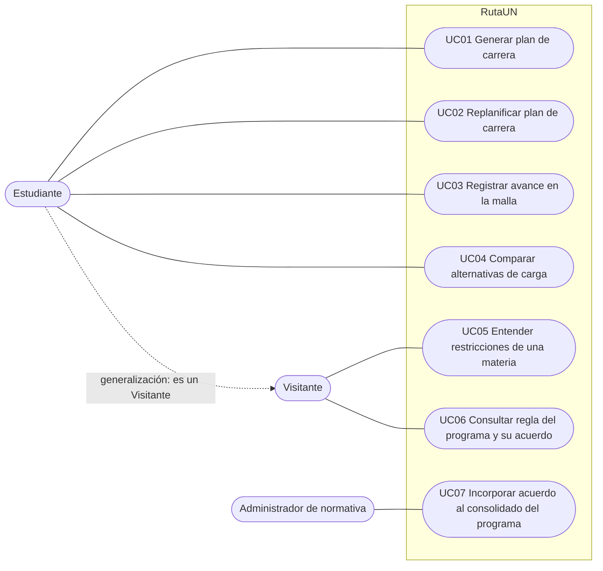

# Índice de casos de uso (UC01–UC07)

> **Índice derivado:** el contenido verbatim por caso está en `./UC01..UC07`. Este archivo lleva la introducción de §9, el diagrama y la navegación de §10, y la intro de §11.

## Casos y archivos

| UC | Archivo | Historias |
|---|---|---|
| UC01 | [UC01-generar-plan-de-carrera.md](UC01-generar-plan-de-carrera.md) | 7 · #1–#7 |
| UC02 | [UC02-replanificar-plan-de-carrera.md](UC02-replanificar-plan-de-carrera.md) | 5 · #8–#12 |
| UC03 | [UC03-registrar-avance-en-la-malla.md](UC03-registrar-avance-en-la-malla.md) | 9 · #13–#21 |
| UC04 | [UC04-comparar-alternativas-de-carga.md](UC04-comparar-alternativas-de-carga.md) | 5 · #22–#26 |
| UC05 | [UC05-entender-restricciones-de-una-materia.md](UC05-entender-restricciones-de-una-materia.md) | 7 · #27–#33 |
| UC06 | [UC06-consultar-regla-del-programa.md](UC06-consultar-regla-del-programa.md) | 5 · #34–#38 |
| UC07 | [UC07-incorporar-acuerdo-al-consolidado.md](UC07-incorporar-acuerdo-al-consolidado.md) | 9 · #39–#47 |

---

## 9. Casos de uso *fully dressed*

Siete casos de uso al nivel de **meta de usuario**, en orden de prioridad, con la plantilla oficial del curso. **Sistema:** RutaUN · **Nivel:** Objetivo de usuario.

## Cómo leer cada caso (leyenda)

**Cómo leer cada caso:** *Interesados e intereses* (I1…In: qué quiere y por qué; las etiquetas `[I-n]` en pasos, extensiones y garantías remiten a ellos) → *Precondiciones* → *Garantía mínima (GM)*: se cumple sin importar el resultado → *Garantía de éxito (GE)*: cuando la meta se cumple → *Disparador* → *Escenario principal de éxito* (el «camino feliz») → *Extensiones*: las excepciones que pueden surgir, identificadas por el número del paso en que ocurren más una letra (p. ej. `4b`); «Cualquiera» = puede ocurrir en cualquier paso.

Las extensiones **vuelven a un paso, continúan en el paso siguiente (si no dicen otra cosa) o terminan**, con éxito o sin cambios (ver las convenciones al inicio del glosario, §7).

## 10. Diagrama UML de casos de uso

El diagrama original (Figura 3.1) es un único diagrama con los tres actores y los siete casos de uso. Se reproduce aquí en texto y en Mermaid.

- **Actores:** Estudiante (UC01–UC04), Visitante (UC05, UC06) y Administrador de normativa (UC07).
- **Generalización Estudiante → Visitante:** un estudiante con sesión también es visitante (usa UC05 y UC06 y, en su propio programa, ve además su avance).
- **Sin `<<include>>` ni `<<extend>>`:** las conexiones entre casos son de **navegación** (el caso de origen termina y el actor pasa al otro), y el cálculo del plan compartido por UC01, UC02 y UC04 **no** se invoca como caso aparte.
- **Sin actores secundarios:** RutaUN no se integra con el SIA ni consulta Régimen Legal en vivo.
- Frontera del sistema: **RutaUN**.

### Navegación entre casos (derivada de las extensiones; no figura como tabla en los PDF)

Los casos no se invocan entre sí; el actor «pasa» de uno a otro y el caso de origen **termina sin cambios**. Principales pasos de navegación que citan los casos:

| Desde | Hacia | Cuándo |
|---|---|---|
| UC01 | UC03 | Sin avance registrado (2a); marcas «en curso» por actualizar (2c) |
| UC01 | UC02 | Ya hay plan vigente (2f) |
| UC01 | UC04 | Quiere ver varias cargas a la vez (7a) |
| UC01 | UC03 | Faltan semestres cursados para comparar con la malla estándar (7d) |
| UC02 | UC03 | Marcas «en curso» por actualizar (2b); atrasos ya resueltos (2f); semestres cursados antiguos (2i, 2j) |
| UC02 | UC04 | Quiere ver varias cargas a la vez (8a) |
| UC03 | UC02 | El avance guardado deja desactualizado el plan vigente (paso 9) |
| UC03 | UC01 | No hay plan vigente (9a) |
| UC04 | UC03 | Sin avance (2a); marcas «en curso» por actualizar (2f) |
| UC04 | UC02 | Para cambiar optativas fijadas (2h) |
| UC05 | UC06 | Se entra desde la malla o el cuadro de prerrequisitos del programa consultado |
| UC05 | UC03 | Se entra desde «Registrar avance en la malla» (estudiante con sesión) |
| UC06 | UC05 | Seleccionar una materia en la malla o el cuadro de prerrequisitos (4b) |
| UC06 | UC03 | «Mi programa»: pasar a registrar avance (3a) |

## 11. Historias de usuario

**47 historias**, derivadas de los siete casos de uso. Convenciones: **GE n** = garantía de éxito n · **GM n** = garantía mínima n · **ext.** = extensión · **paso** = paso del escenario principal. Los criterios de aceptación remiten a pasos, extensiones y garantías del caso de uso correspondiente (§9). Cada historia es un *issue* del backlog (§12); el número entre paréntesis es el número del issue en GitHub.

| Caso de uso | Historias |
|---|---|
| UC01 · Generar plan de carrera | 7 |
| UC02 · Replanificar plan de carrera | 5 |
| UC03 · Registrar avance en la malla | 9 |
| UC04 · Comparar alternativas de carga | 5 |
| UC05 · Entender restricciones de una materia | 7 |
| UC06 · Consultar regla del programa y su acuerdo | 5 |
| UC07 · Incorporar acuerdo al consolidado del programa | 9 |
